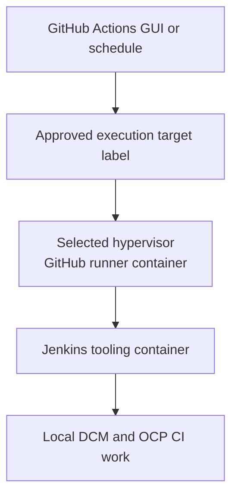
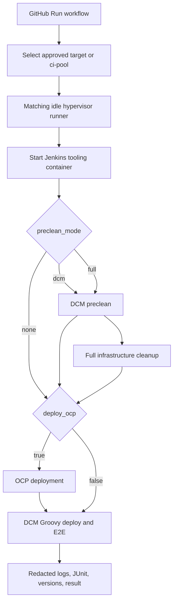

# DCM CI Modernization Enhancement

## Goal

Replace central Jenkins management with GitHub Actions. Keep the current
Jenkins Groovy jobs as a supported long-term execution option.

Success is removing the centrally managed Jenkins service. Retiring the local
Jenkins execution container and Groovy is optional.

Each prepared hypervisor is both a GitHub self-hosted runner and the host where
its DCM/OCP CI job runs. GitHub provides the parameter form, schedule, run
history, artifacts, and host selection.

```text
GitHub Actions GUI / schedule
          |
          | selects a runner label
          v
Prepared hypervisor
  GitHub runner container
          -> starts local Jenkins execution container for this run
          -> executes existing Jenkins Groovy jobs
          -> performs local Podman/libvirt/OCP/DCM work on this host
```



This document is a plan. It does not authorize changes to any hypervisor,
runner, Jenkins configuration, repository, Quay image, or credential store.

## Why each hypervisor has a runner

Dedicated CI runner hosts are not an option for this design. We need many CI
jobs to run in parallel.

```text
Each hypervisor has one GitHub runner.

Named-target run
  -> user selects an approved runner label

Shared CI run
  -> GitHub selects any free hypervisor with the ci-pool label
```

One runner runs one job at a time. More prepared hypervisors mean more parallel
CI jobs.

## Chosen architecture

Each CI hypervisor has:

- a GitHub self-hosted runner container, installed once and kept registered;
- host tooling prepared once by the node-preparation job;
- a local keystore/password source for deployment credentials;
- a local Jenkins execution container that the runner starts for each CI run;
- one active CI job at a time.

The local Jenkins execution container is the first execution engine. It can
also stay as the long-term execution engine. It comes from an approved Quay
image. It has Jenkins plugins, Groovy jobs, shared-library access, and common
pip/Ansible tooling. The runner stays installed and starts this container for
each CI run. It waits for readiness, runs the jobs, collects results, and then
stops or removes the run container.

The runner image and Jenkins tooling image contain **no secrets**. Pin their
Quay digests for reproducibility and rollback.

## Stages

### Stage 1 — one-time host preparation

Prepare each hypervisor once for CI. Then deploy and register one GitHub CI
runner on that hypervisor.

Keep the runner state, local Jenkins state, and local secret configuration
outside the DCM and full-cleanup paths.

### Stage 2 — CI execution

Each manually-triggered or scheduled GitHub workflow follows this order:

```text
1. User/schedule chooses execution_target and parameters in GitHub.
2. GitHub routes the job to the matching idle runner.
3. Runner performs preflight and starts the local Jenkins execution container.
4. Run the requested preclean mode.
5. Deploy OCP through the OCP deployment stage when deploy_ocp=true.
6. Run the DCM deployment job with duplicate cleanup/OCP deployment disabled.
7. Run E2E tests; publish redacted logs, JUnit, versions, and result.
8. Apply the selected teardown policy and preserve the runner/Jenkins state.
```

OCP deployment belongs to this execution stage, not to node preparation.
If the local Jenkins execution container does not become ready or does not
return a job result, fail the GitHub workflow before deployment starts.



### Stage 3 — optional incremental modernization

This stage is optional. The architecture is complete once GitHub replaces
central Jenkins management, even if every hypervisor continues to use its local
Jenkins execution container and Groovy indefinitely. GitHub remains the UI,
scheduler, host selector, and artifact/result layer.

When desired, replace individual stages one at a time with versioned scripts or
Ansible while retaining the same input and artifact contracts:

```text
DCM preclean                 -> Jenkins Groovy now; native script later
Full infrastructure cleanup  -> Jenkins job now; native code later
OCP deployment               -> Jenkins job now; native code later
DCM deploy and E2E           -> Jenkins Groovy now; native scripts later
```

GitHub workflow configuration selects the approved engine for each stage:

```text
preclean_engine: jenkins | native
ocp_engine:      jenkins | native
dcm_engine:      jenkins | native
```

Do not expose arbitrary Jenkins job names or shell commands as GUI input. The
workflow may offer only reviewed engine choices. Retiring the local Jenkins
execution container is optional and happens only if every required stage has a
validated native replacement.

## Labels and GitHub GUI routing

Each runner has common labels plus a unique host label.

```text
Named-target runner example
  self-hosted, linux, dcm-ci, target-a

Shared CI host example
  self-hosted, linux, dcm-ci, target-b, ci-pool
```

Dedicated runners must **never** receive the `ci-pool` label.

Runner labels route work; they do not authorize users. A GitHub dropdown alone
cannot stop one user from selecting a target they should not use. Restrict
workflow-dispatch permissions, use protected environments, or use separate
target-specific workflows/repositories when ownership needs enforcement.

The GitHub workflow exposes an approved dropdown:

```text
execution_target:
  - target-a
  - target-b
  - ci-pool
```

Workflow routing uses the selected label:

```yaml
runs-on: [self-hosted, linux, dcm-ci, "${{ inputs.execution_target }}"]
```

```text
execution_target=target-a
  -> runs only on the selected named-target runner

execution_target=ci-pool
  -> GitHub chooses any idle shared runner with ci-pool
```

One runner executes one job at a time. Multiple prepared hypervisors provide
parallel CI capacity. If a host is being used outside GitHub, disable its
runner or remove its `ci-pool` label before shared CI can select it.

Use only approved GUI choices. Do not allow arbitrary hostnames or runner
labels as free-text input.

## Workflow inputs

| Input | Values | Purpose |
| --- | --- | --- |
| `execution_target` | approved runner label or `ci-pool` | Select one named target or an idle shared CI runner. |
| `preclean_mode` | `none`, `dcm`, `full` | Select exactly one cleanup scope. |
| `deploy_ocp` | `true`, `false` | Run the OCP deployment stage only when OCP deployment is requested. |
| `cluster_name` | approved name | Name used for OCP deployment. |
| `ocp_version` | approved version | OCP version passed to the OCP deployment stage. |
| `deploy_rhdh` | `true`, `false` | Maps to the existing RHDH Jenkins checkbox. |
| `enable_dcm_auth` | `true`, `false` | Maps to the existing RHBK/DCM auth checkbox. |
| `enable_acm` | `true`, `false` | Maps to the ACM provider checkbox. |
| `deploy_metallb` | `true`, `false` | Maps to the MetalLB checkbox. |
| `label_filter` | approved Ginkgo filter | Select E2E scope. |

## Preclean contract

Use one explicit `preclean_mode`; do not combine ambiguous cleanup booleans.

```text
none
  -> no preclean action

dcm
  -> remove DCM stack only
  -> remove DCM containers, pod, network, and DCM volumes
  -> verify DCM ports are free
  -> verify no DCM containers remain
  -> leave OCP, RHDH, RHBK, MetalLB, ACM, VMs, and Terraform unchanged

full
  -> run DCM preclean
  -> run full infrastructure cleanup
```

Full preclean must never delete the runner state, Jenkins state, keystore
access, or other paths established in Stage 1. It may still remove all CI
workload, OCP, VM/libvirt, and infrastructure resources covered by the cleanup job.

## Jenkins/Groovy execution model

For the initial and optionally long-term model, the GitHub runner starts the
local Jenkins execution container on the selected hypervisor and supplies the
workflow parameters. No central Jenkins controller selects or manages these
hosts. The local container executes the existing jobs in sequence:

```text
if preclean_mode=dcm:
  DCM preclean only

if preclean_mode=full:
  DCM preclean
  -> full infrastructure cleanup

if deploy_ocp=true:
  OCP deployment stage

then:
  DCM deployment job
```

The DCM deployment job must always receive:

```text
PRECLEAN=false
DEPLOY_OCP_CLUSTER=false
```

This prevents the DCM Groovy pipeline from calling cleanup or OCP deployment a
second time.

The existing Jenkins component checkboxes define component behavior:

```text
INSTALL_RHDH_OPERATOR=true  -> redeploy/reconcile RHDH
INSTALL_RHDH_OPERATOR=false -> leave existing RHDH unchanged

ENABLE_DCM_AUTH=true        -> deploy/reconcile the RHBK/DCM auth path
DEPLOY_METALLB=true         -> deploy/reconcile MetalLB configuration
ENABLE_ACM_CLUSTER_SP=true  -> deploy/reconcile the ACM provider path
ENABLE_KUBEVIRT_SP=true     -> deploy/reconcile the KubeVirt provider path
```

The current Groovy and its child jobs must be supplied with all required Jenkins
plugins, job definitions, shared-library configuration, local credential
access, and a local execution agent/label. Do not assume that a Groovy file can
run by itself without this Jenkins configuration.

## Tooling images

Use versioned Quay images for consistent global tooling:

```text
quay.io/<organization>/dcm-ci-runner@sha256:<digest>
  - GitHub runner, Ansible/SSH client, CI wrapper tools

quay.io/<organization>/dcm-ci-jenkins-tools@sha256:<digest>
  - Jenkins runtime/plugins, job definitions, shared-library access
  - Python/pip tooling, Ansible collections, CI helpers
```

Convert runtime `pip install` behavior into pinned image dependencies wherever
practical. This makes the existing Jenkins tooling portable and consistent
across hypervisors while avoiding random package-download failures during a CI
deployment.

## Safety and operational rules

- Privileged CI runners accept only trusted manual or scheduled workflows from
  protected branches/repositories. Never run fork or untrusted PR code on them.
- A runner label routes work; it does not prove a hypervisor is safe or unused.
  Run host preflight checks for disk, required ports, old containers, and
  conflicting deployments.
- A full cleanup failure stops the workflow before OCP deployment.
- An OCP deployment failure stops the DCM deployment job.
- Missing JUnit means failed or inconclusive; never report a green full test
  run with zero/missing test evidence.
- Redact secrets from console logs, artifacts, and test reports.
- Record image digests, workflow inputs, resolved source revisions, selected
  host label, and result in a run manifest.

## Validation status

Treat this document as a proposed operating model until runner registration,
Jenkins-container packaging, and the local keystore approach are approved and
tested.
